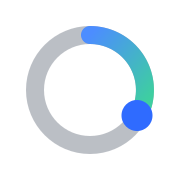
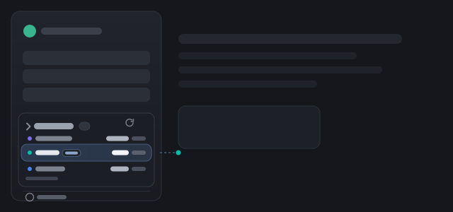

# OFM credit dock

> **Requires [Our Free Model](https://github.com/Ebony-Vinyl/dsh-our-free-model) (`dsh-our-free-model`).**
> This plugin is a **read-only companion to Our Free Model's "EAC router" channels**. It has no
> channels of its own and ships no credentials. With Our Free Model absent or disabled it shows
> nothing but an explanation.

Shows every **EAC router** channel you have signed in to — and its remaining credit — at the
bottom of the DSH sidebar, with the channel behind your current model highlighted.



## What it shows

One row per **connected** provider, in Our Free Model's own channel order:

- **Provider name** and its remaining credit
- **Highlighted row + 「使用中」/「In use」 badge** — the provider your current session's model
  belongs to
- **Units as the provider reports them**, never converted or summed together:

  | Channel | Unit |
  |---|---|
  | LobsterAI, Qoder, Qoder CN, TRAE, Loomy, Raccoon, MiniMax Code | credits / points |
  | Cline | USD |
  | ZCode | tokens |
  | Gemini | quota window percentage |

- A provider whose balance query fails shows **why**, not `0` — `0` would read as "spent up",
  which is a different claim.
- With several accounts on one provider, credits are summed; **quota percentages are averaged**
  and labelled as such, because a percentage of a window is not an additive quantity.

Collapsed sidebar → the dock becomes a 36px rail button; its tooltip names the in-use provider
and its balance.

## Requirements

| Requirement | Notes |
|---|---|
| **`dsh-our-free-model`** | **Required.** Provides the channels and the RPC this reads. |
| At least one channel signed in | Sign in on Our Free Model's **EAC router** page. |
| DSH Web GUI | `dsh.client.platform` is `web`. |

The ten channels are the ones Our Free Model mounts. If it adds an eleventh, this plugin will
not list it until it is updated here (`CHANNELS` in `client.js`); unknown providers are ignored
rather than guessed at.

## Install

```sh
dsh plugin --profile web add github:zhang-astronaut/dsh-ofm-credit-dock
```

Then install Our Free Model if you have not already:

```sh
dsh plugin --profile web add github:Ebony-Vinyl/dsh-our-free-model
```

## How it works

The dock is browser-side only; `index.js` exists to give the bundle a plugin row.

1. It asks Our Free Model's channel RPC over the shell's `connection` service — the same
   transport Our Free Model's own settings page uses, so the Host's admission and origin policy
   apply:
   - `provider.status` → which of the ten channels have at least one account
   - `credits.balances` → one balance reading per connected channel
2. The highlight comes from the session list row's `modelSelection` projection
   (`next ?? lastUsed`) — the same value the composer's model seat displays. Each account
   channel is registered as its own LLM provider (`trae`, `qodercn`, `zcode`, …), so the
   selection's provider id names the channel outright. A selection on `our-free-model` is the
   free lane, spends no channel credit, and highlights nothing.
3. It re-reads every 90 s, on window focus, and when Our Free Model announces a channel change
   (`ofm:channels`). Hint-driven re-reads are floored at 15 s so tab switching cannot stack
   overlapping sweeps; the refresh button re-reads immediately.

**Nothing is read from or written to the credential store.** No balance is cached to disk, and
no request goes anywhere Our Free Model itself would not have made.

## Privacy

The plugin reads credit sums that Our Free Model already fetched. It sends nothing to any
third party, has no analytics, no telemetry, no network endpoint of its own, and writes no
files. Turning it off removes the dock and changes nothing else.

## Known limitations

- **Requires Our Free Model.** This is a companion, not a standalone channel plugin.
- The channel list is a fixed table of ten. A provider Our Free Model adds later appears only
  after this plugin is updated.
- Balances are as fresh as the last read (up to 90 s old); the footer shows the reading time.
- A provider whose credential expired shows "Query failed" with the reason in the tooltip
  until it is re-authenticated on Our Free Model's page.
- Free-lane (`our-free-model`) sessions highlight nothing, because no channel credit is spent.

## License

MIT.
