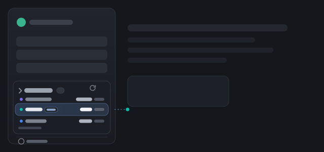

# OFM 额度停靠条

> **依赖 [Our Free Model](https://github.com/Ebony-Vinyl/dsh-our-free-model)（`dsh-our-free-model`）。**
> 本插件是 Our Free Model「EAC router」渠道的**只读伴随插件**：它自己不含任何渠道、不携带任何凭据。
> 没装 Our Free Model、或它未启用时，本插件只会显示一句说明，不会有任何数字。

在 DSH 侧栏最下方列出你在 **EAC router** 中已登录的每个渠道及其剩余 credit，
当前模型所属渠道高亮显示。



## 它显示什么

每个**已连接**厂家一行，顺序沿用 Our Free Model 自己的渠道顺序：

- **厂家名**与剩余 credit
- **高亮行 +「使用中」标记**——当前会话所用模型属于该厂家
- **单位按各厂家实际口径原样显示**，不做跨渠道换算，也不相加：

  | 渠道 | 单位 |
  |---|---|
  | LobsterAI、Qoder、Qoder 中国版、TRAE、Loomy、Raccoon、MiniMax Code | 积分 |
  | Cline | 美元（USD） |
  | ZCode | Token |
  | Gemini | 额度窗口百分比 |

- 查询失败的厂家显示**原因**而不是 `0`——`0` 是「已用光」的语义，那是另一种断言。
- 同一厂家多个账号：积分相加；**百分比取平均并标注**，因为窗口百分比不是可叠加的量。

侧栏收起时变成一个 36px 图标按钮，悬停提示给出使用中的厂家及其余额。

## 前提

| 要求 | 说明 |
|---|---|
| **`dsh-our-free-model`** | **必需。** 渠道与所读的 RPC 都由它提供。 |
| 至少登录一个渠道 | 在 Our Free Model 的 **EAC router** 页登录。 |
| DSH Web 界面 | `dsh.client.platform` 为 `web`。 |

十个渠道就是 Our Free Model 当前挂载的那些。它以后新增第十一个渠道时，本插件需要更新
（`client.js` 里的 `CHANNELS`）才会认识；不认识的厂商会被忽略，而不是瞎猜数字。

## 安装

```sh
dsh plugin --profile web add github:zhang-astronaut/dsh-ofm-credit-dock
```

若还没装 Our Free Model：

```sh
dsh plugin --profile web add github:Ebony-Vinyl/dsh-our-free-model
```

## 它是怎么工作的

逻辑全在浏览器侧，`index.js` 只是为了让这个包有一个插件条目。

1. 通过宿主 shell 的 `connection` 服务调用 Our Free Model 的渠道 RPC——与它自己的设置页
   走同一条通道，因此宿主的准入门禁与同源策略照常生效：
   - `provider.status` → 十个渠道里哪些至少有一个账号
   - `credits.balances` → 逐个已连接渠道读余额
2. 高亮取自会话列表行的 `modelSelection` 投影（`next ?? lastUsed`）——即输入框模型菜单
   显示的那个值。每个账号渠道都注册为独立的 LLM provider（`trae`、`qodercn`、`zcode`…），
   所以选中项的 provider id 直接就是渠道名。选在 `our-free-model` 上属于免费车道，
   不消耗任何渠道额度，因此不高亮任何一行。
3. 每 90 秒、窗口重新获得焦点时、Our Free Model 广播渠道变化（`ofm:channels`）时重新读取。
   由提示触发的读取有 15 秒下限，避免反复切标签页叠起重扫；刷新按钮立即重读。

**不读取也不写入凭据库。** 不把余额落盘，也不会发往 Our Free Model 本身不会发的地方。

## 隐私

本插件只读取 Our Free Model 本来就已经取回的额度汇总。它不向任何第三方发送内容，
没有统计、没有遥测、没有自己的网络端点，也不写文件。关掉它只会移除停靠条。

## 已知限制

- **依赖 Our Free Model。** 它是伴随插件，不是独立的渠道插件。
- 渠道表是固定的十个。Our Free Model 之后新增的厂商，要等本插件更新后才会出现。
- 额度新鲜度取决于最后一次读取（最多 90 秒前），页脚会显示读取时间。
- 凭据过期的厂家会显示「查询失败」，悬停可见原因，需到 Our Free Model 页面重新登录。
- 免费车道（`our-free-model`）的会话不会高亮任何一行，因为不消耗渠道额度。

## 许可

MIT。
